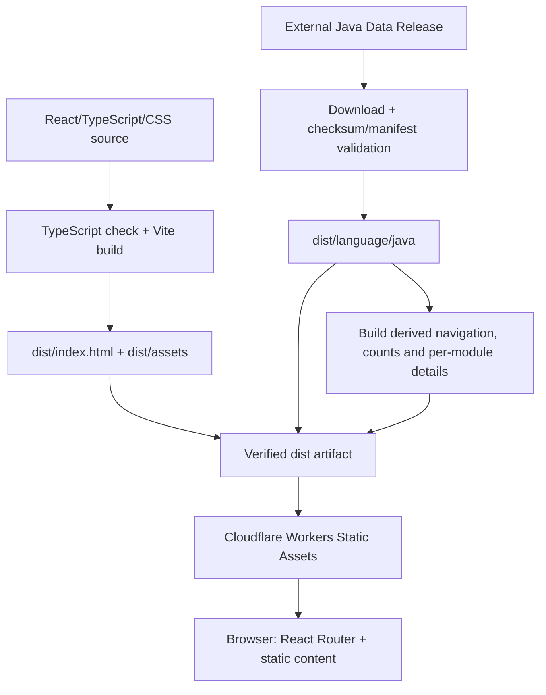
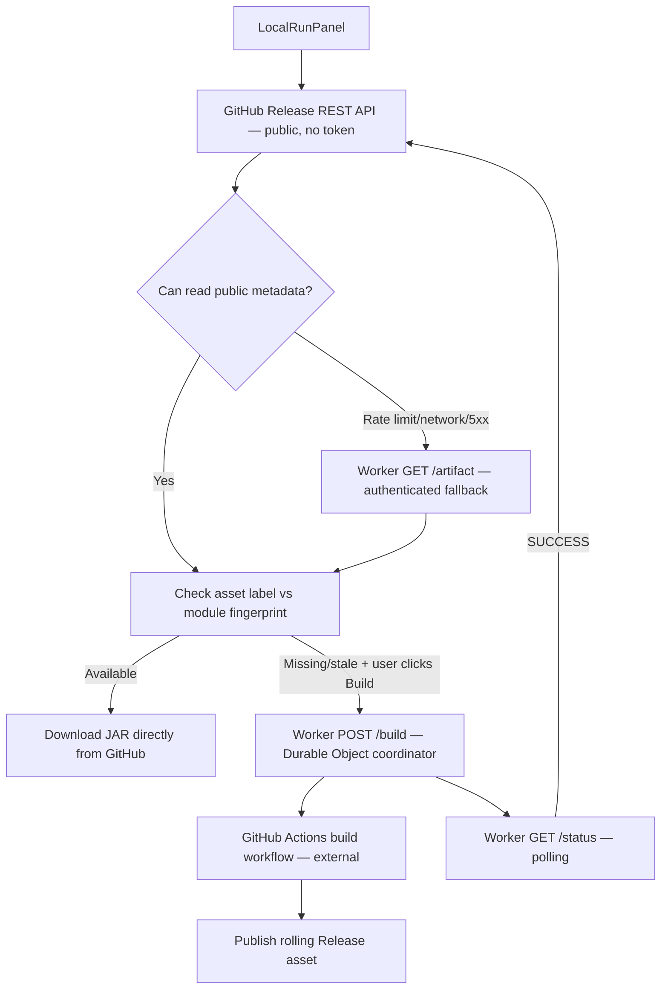
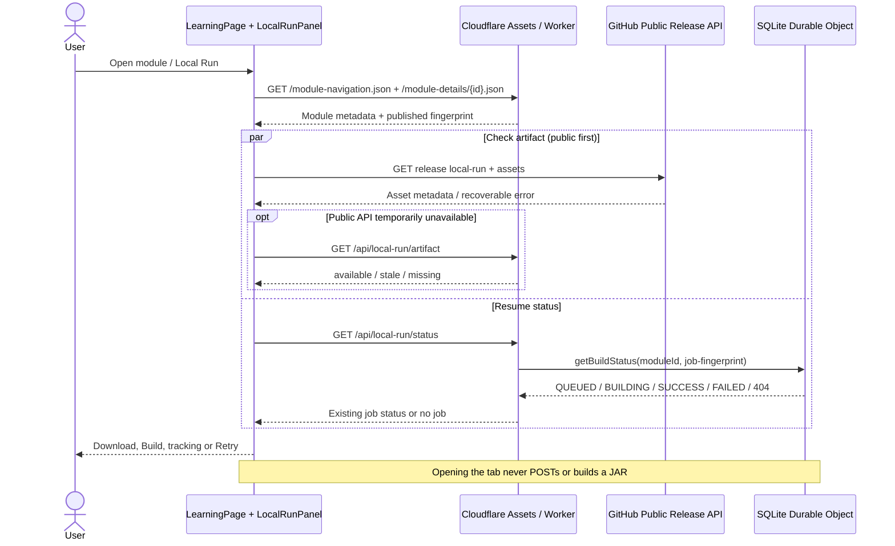
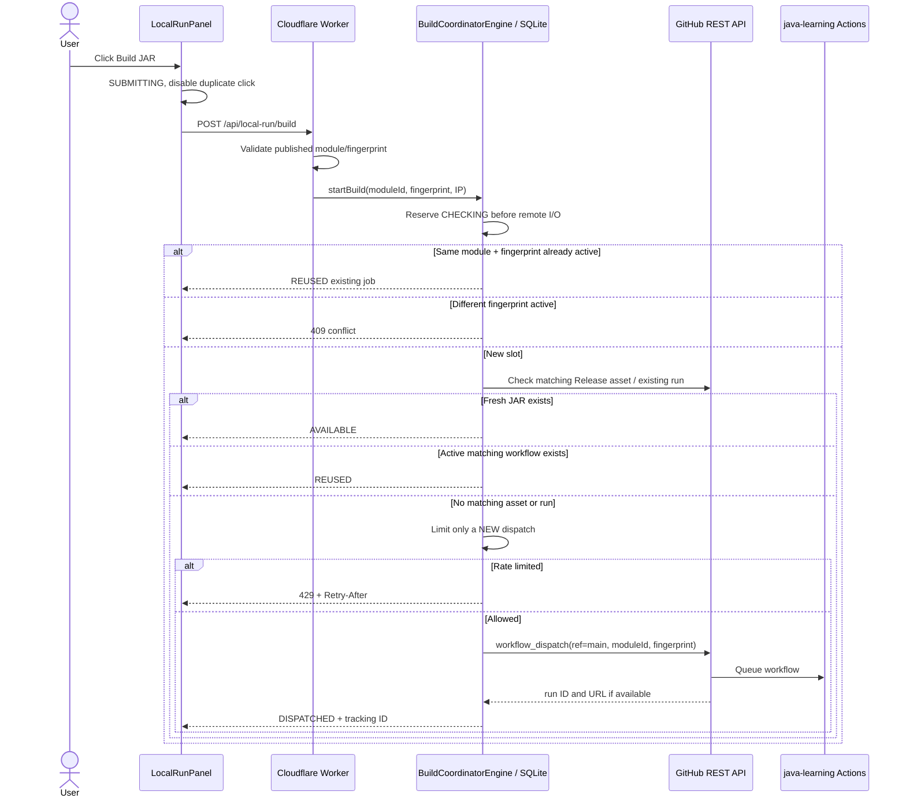
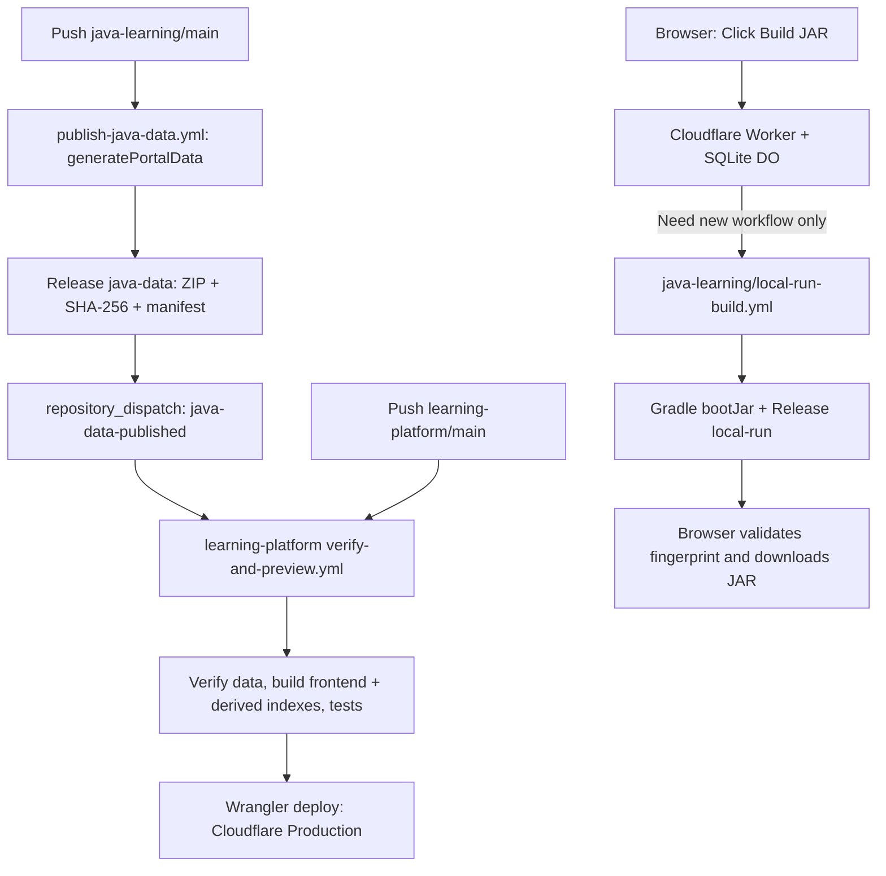

# Learning Platform — Product, Frontend & Cloudflare Worker Architecture

## 1. Trạng thái và ownership

Tài liệu này mô tả **kiến trúc và trải nghiệm người dùng của `learning-platform`**, website duy nhất còn được duy trì sau khi xóa application `java-learning/project-portal/` cũ. Website standalone dùng React 19, TypeScript, Vite, React Router, CSS thuần và Cloudflare Worker API giới hạn cho Local Run. Đây là **learning-data frontend consumer + lightweight build coordinator**, không phải module Spring Boot hoặc Gradle project; Java compilation vẫn chạy trong `java-learning` GitHub Actions. Các lệnh vận hành, CI/CD và cách đồng bộ nội dung nằm trong [README.md](README.md).

### 1.1 Cấu trúc repository hiện tại

```text
learning-platform/
├── src/
│   ├── main.tsx                 # React entry
│   ├── App.tsx                  # Routes / application shell
│   ├── pages/                   # Home, Learning, Project, About Me
│   ├── components/              # Module dashboard / content panels
│   ├── data/                    # Static Java data clients / mappings
│   ├── state/                   # Theme and language state
│   └── styles/
├── worker/                      # Cloudflare Worker API + SQLite Durable Object
│   ├── index.ts                 # /api/local-run/* routes and validation
│   └── local-run/               # Coordinator, GitHub API, catalog contract
├── scripts/                     # Java ZIP consumer, derived indexes and validation
├── .github/workflows/           # Build, preview and production deploy
├── wrangler.jsonc               # Cloudflare Assets + API/DO/limiter bindings
├── package.json
└── dist/                        # Generated, ignored deployable output
    ├── index.html
    ├── assets/
    ├── module-navigation.json   # Lightweight progressive navigation
    ├── module-content-counts.json
    ├── module-details/{ROUTE_ID}.json
    └── language/java/
        ├── module-catalog.json  # Full producer-owned catalog
        ├── module/
        └── search/
```

`dist/` không chứa nội dung được hand-author tại repository này. Static learning data hiện được **tải từ một Java Data Release bên ngoài**, kiểm tra SHA-256/manifest, rồi đồng bộ vào `dist/language/java/`. Không sửa thủ công các bản sao generated hoặc ghi ngược sang upstream. Cách publish nguồn nằm ngoài phạm vi tài liệu frontend này.

### 1.2 Build và serve model



Frontend không chạy trong JVM; React chạy trong browser. `npm run dev` dùng Vite cùng Java data và các index đã đồng bộ; `npm run build` tạo deployable `dist/` (Vite frontend, sync ZIP, build counts và navigation). Production deploy Worker `learning-platform` và xác minh nội dung trên **cả** `https://learning-platform.phuongnguyenit93.workers.dev` và `https://nguyendodinhphuong.name.vn`. Pull request không tự deploy production. Xem [README.md](README.md) để biết chính xác các trigger/gate CI/CD.

### 1.3 Frontend technologies / UX conventions

React quản lý UI/components; TypeScript kiểm tra type; Vite build và HMR; React Router xử lý clean client URLs và legacy redirects; CSS dùng semantic class names. Theme có Light/Dark, ưu tiên `prefers-color-scheme` lần đầu và giữ lựa chọn của user trong `localStorage`.

Semantic color convention: Overview gray, Knowledge blue, Quiz amber, Interview teal, API Docs red, Local Run purple, Download green. Các màu là UI convention chứ không quyết định availability.

### 1.4 Runtime boundaries

- Learning pages, Knowledge, Roadmap, Quiz, Interview và API reference đọc static assets, không cần application server của module.
- Cloudflare Static Assets xử lý SPA deep links bằng `not_found_handling: single-page-application`.
- Local Run is available for published runnable SERVLET/REACTIVE modules without frontend/backend enable toggles. The Cloudflare Worker validates GitHub credentials, same-origin requests, published fingerprint, Durable Object deduplication and rate limits. Preview keeps isolated DO and limiter bindings; with a GitHub secret it can also dispatch. UI visibility is not API authorization.
- Các ngôn ngữ khác ngoài Java có thể có producer/dataset riêng về sau; không giả định tất cả source đều là Java.

---

## 2. Bài toán sản phẩm

Người học cần một điểm truy cập thống nhất cho Overview, Roadmap, Knowledge, Quiz, Interview và API Docs mà không phải khởi động ứng dụng riêng cho từng module. Content không nên phụ thuộc vào Swagger hay runtime đang chạy; Swagger/live execution chỉ là capability tùy chọn. Các module chỉ có tài liệu hoặc quiz vẫn phải đọc được trên browser.

**Nguyên tắc:** website là lớp trình bày nội dung đã xuất bản; không biên dịch module hoặc tự tạo knowledge tại runtime.

---

## 3. Ý tưởng chính

Learning Platform là entry point chung cho nhiều lĩnh vực học; Java Knowledge là nhánh nội dung hiện có. UI không hard-code cấu trúc chương trình học hay nội dung từng module. Catalog quyết định hierarchy, source data quyết định Knowledge/Quiz/Interview/API, còn React quyết định cách người dùng điều hướng và tương tác.

```text
Learning Platform
├── Learning topic picker (Java / JavaScript / NodeJS)
│   └── Java Knowledge
│       ├── Overview / Roadmap / Menu / Knowledge
│       ├── Quiz / Interview / API Docs
│       └── Local Run (runnable SERVLET/REACTIVE, production enabled)
├── Project
└── About Me
```

---

## 4. Trang module hiện tại và mục tiêu

Learning hiện có hai lớp điều hướng trước khi tới module dashboard:

```text
Header: Home | Learning | Project | About Me
   ↓
/learning
   → Topic picker: Java | JavaScript | NodeJS
   → Java opens /learning/java/knowledge
   → JavaScript / NodeJS show localized, animated unavailable-content dialog
   ↓
Java section navigation: Knowledge
   → Knowledge contains the existing module tree/dashboard/tabs
```

Đây là **navigation/presentation hierarchy** mới; `Java → Knowledge` bao bọc **toàn bộ** learning module UI hiện tại và không đồng nghĩa với tab `Knowledge` nằm bên trong một module. Java section navigation nằm giữa, ngay dưới global header, chỉ còn mục Knowledge và nút quay lại danh sách chủ đề. Project là một mục độc lập của primary header, không nằm trong Java Learning. VI/EN áp dụng cho cả unavailable modal và nội dung Project.

`Project` hiện có route canonical duy nhất `/project`, được truy cập trực tiếp từ primary header bên phải Learning **không cần chọn ngôn ngữ**. `/learning/java/project` không còn render Project trong Java; đường cũ chỉ redirect sang `/project` và giữ query/hash. Component `ProjectPage.tsx` có ba thẻ domain study Banking, Logistics, E-commerce; eyebrow chỉ là `Project`, không còn nhãn `JAVA / PROJECT` hoặc dòng hướng dẫn hover/chạm. Các thẻ xếp dọc, chiếm toàn bộ chiều rộng của content area; tông màu khác nhau theo từng domain. Trạng thái thường dùng linear gradient đậm → nhạt từ trái sang phải; trên hover/focus/click, đường chéo chuyển thành split thẳng đứng với vùng logo và vùng mô tả là hai nền **màu phẳng** khác tông. Logo SVG luôn một màu, vị trí icon và split pane luân phiên hai phía theo từng thẻ. Mỗi thẻ là một nút disclosure chỉ mở mô tả, chưa dẫn tới một module/project implementation. Touch click toggle, keyboard focus và `prefers-reduced-motion` đều được hỗ trợ; mô tả được localized VI/EN.

Global header brand thay đổi theo route: chỉ các route `/learning/java/**` hiển thị **Java Learning** với SVG Java; `/about-me` hiển thị **Nguyen Do Dinh Phuong** với toàn bộ tên màu xanh và biểu tượng cũ; các route còn lại (bao gồm `/learning` topic picker) hiển thị **Learning Platform** với biểu tượng cũ. Ba topic card trên `/learning` hiển thị SVG logo Java/JavaScript/NodeJS thay cho chữ viết tắt; logo được đóng gói trực tiếp từ `src/assets/logos/` (Devicon, kèm MIT license), không fetch logo qua CDN lúc runtime.

`PageMetadata.tsx` cập nhật favicon và `document.title` theo React Router location, độc lập với Header: `/` và `/learning` dùng favicon gốc + `Learning Platform`; `/learning/java/knowledge/**` dùng SVG Java + `Java Learning - Knowledge`; `/project` dùng favicon gốc + `Project - Learning Platform`; `/about-me` dùng favicon gốc + `Nguyen Do Dinh Phuong`. Khi client-side navigate, browser-tab metadata đổi không cần reload. `index.html` giữ fallback title `Learning Platform`.

`About Me` (canonical route `/about-me`, legacy `/my-cv` redirects client-side) hiển thị phần tải CV căn giữa: heading **Download My CV**, hai nút PDF/DOC. PDF dùng Google Docs `export?format=pdf`; DOC dùng `export?format=docx` (tệp Microsoft Word .docx). Phía dưới có nút localized `Xem CV Online`/`Ẩn CV của tôi`, lazy-mount iframe Google Docs hiện tại chỉ khi người dùng bật; viewer căn giữa, rộng 80% (100% ở màn hình nhỏ), cao cố định 620px desktop/480px mobile với scroll nội bộ để chừa không gian cho nội dung sau này. Legacy query/hash được giữ khi redirect.

Ví dụ với module runnable `THREAD`:

```text
Thread & Concurrency

[Overview] [Menu] [Roadmap] [Knowledge] [API Docs] [Quiz] [Interview] [Local Run]

Progress
████████░░

Knowledge
1. Basic Thread
2. Interruption
3. Concurrency Problems
...

Quiz
52 questions

Interview
46 questions

API Docs
78 experiments
```

Ví dụ với module không runnable:

```text
Gradle Cache

[Overview] [Menu] [Roadmap] [Knowledge] [Quiz]

Knowledge
1. Cache Concepts
2. Build Cache
3. Configuration Cache
...

Quiz
25 questions
```

Frontend đã dựng navigation shell và các static panels Overview/Menu/Roadmap/Knowledge/API Docs/Quiz/Interview. `Local Run` có UI hai khung Build/Download JAR + Run Locally và **đã hoạt động trên Production** cho module đủ điều kiện; backend Worker quản lý Build/reuse, GitHub Actions build JAR và Release cung cấp file download (xem mục 13).

`Roadmap` nằm kế bên `Menu` nhưng có responsibility khác:

```text
Roadmap
→ milestone cấp cao
→ thứ tự học
→ quan hệ trước/sau và dependency
→ cho learner biết đang ở đâu và học gì tiếp theo

Menu
→ danh sách Knowledge chapter/section cụ thể
→ điều hướng chi tiết vào nội dung
```

Roadmap interaction có hai loại relation riêng: `relatedKnowledge` thuộc module hiện tại và luôn hiển thị ở phía đối diện milestone trên timeline, click item sẽ chuyển sang đúng Knowledge category; numbered marker vẫn giữ pulse animation để nhấn mạnh milestone có Knowledge hỗ trợ. `relatedModules` hiển thị thành card phụ cạnh milestone và click để chuyển sang module khác. Cả hai chỉ là navigation/support relation, không tạo nested curriculum graph và không thay đổi learning order của Level 1. Roadmap data và frontend Roadmap tab đều đã implement; frontend tôn trọng thứ tự milestone và prerequisite do dataset cung cấp.

Visual contract hiện tại:

```text
milestone ở trái  ···  (marker pulse)  ···  Related Knowledge ở phải
Related Knowledge trái  ···  (marker pulse)  ···  milestone ở phải

Related Modules
→ satellite card nằm ngoài milestone card khi được khai báo
→ click sang module đích
```

`relatedKnowledge` resolve title + section count từ Knowledge index hiện hành; click item chuyển sang tab `Knowledge` và active category tương ứng, không reload module. Marker pulse là affordance thị giác, không còn là trigger mở popup.

Các tab/action về lâu dài phải được render theo capability thực tế của module.

Không nên tạo Spring Boot Application giả chỉ để module có thể hiển thị README hoặc quiz.

---

## 5. Navigation theo module hierarchy

Sidebar và module picker được dựng từ **projection của catalog đã publish**, không từ hard-coded Java categories. Producer-owned `dist/language/java/module-catalog.json` vẫn là source of truth, nhưng React **không tải toàn bộ catalog lớn khi khởi tạo menu**. Sau khi `scripts/build-module-navigation.mjs` tách dữ liệu, browser dùng `/module-navigation.json` (~121 KB ở dataset kiểm chứng ngày 2026-10-12) trước, rồi chỉ tải `/module-details/{ROUTE_ID}.json` của module được chọn. Catalog gốc còn dùng ở Worker để validate Build.

```text
java-data Release → verified full catalog
   ↓ build-module-navigation.mjs (CI/build time)
module-navigation.json → render sidebar sớm
   ↓ chọn module
module-details/{ROUTE_ID}.json → dashboard / Local Run capability
   ├── module-content-counts.json → badges độc lập (~46 KB)
   └── localized feature assets → tải theo tab/section đang mở
```

Frontend phải tôn trọng thứ tự sibling do catalog cung cấp; không tự suy luận module ordering từ filesystem hay parse các file mô tả hierarchy ngoài dataset. Search có thể prune ancestor/descendant để hiển thị kết quả nhưng không được thay đổi catalog gốc. GROUP/MODULE mixed và terminal GROUP có cách tương tác được mô tả trong mục 20.

**Lý do chuyển sang progressive loading sau đợt Production Local Run (2026-10-12):** trước đây React đợi full catalog gần 0,9 MB rồi mới dựng menu; một số edge requests chậm hoặc trả HTTP 500 khiến Learning có cảm giác bị khóa. Hotfix [`1bfbb2f`](https://github.com/phuongnguyenit93/learning-platform/commit/1bfbb2f) thêm retry catalog, tách badges thành count summary; [`8d4fabc`](https://github.com/phuongnguyenit93/learning-platform/commit/8d4fabc) tách navigation nhẹ và 295 per-module details. `src/data/moduleCatalog.ts` có bounded retry (3 attempts, request timeout 12 giây) và UI có nút retry khi navigation lỗi; count summary không được chặn sidebar render. **Progressive rendering chỉ áp dụng frontend startup**, Worker `POST /build` vẫn đọc full producer-owned catalog để validate fingerprint.

---

## 6. Data contract: Module Catalog

Frontend chỉ đọc **machine-readable catalog đã publish và các frontend projection build-time từ chính catalog đó**, không đọc trực tiếp upstream module metadata/registry hoặc Java source. Consumer boundary:

```text
dist/language/java/module-catalog.json
├── root / children / kind (GROUP or MODULE)
├── routeId / serviceName / moduleType / description
├── sourceFingerprint (khi được cung cấp)
├── overview / knowledge / roadmap / quiz / interview / api / reference
└── localized static paths and counts
```

`src/data/javaAsset.ts` ánh xạ các absolute source-data URLs `/module/...` và `/search/...` sang namespace runtime `/language/java/...`; không sửa nội dung tải về. `module-details`, `module-navigation`, `module-content-counts` là **derived frontend indexes** ở ngoài `dist/language/java/`, không ghi ngược vào dữ liệu đã xác minh. Sidebar render trước, số lượng câu hỏi hydrate độc lập, content lazy-load theo tab. Một language/capability chỉ được hiển thị khi dữ liệu tương ứng hợp lệ; catalog không tạo entitlement cho một live API chưa deploy.

---

## 7. Capability model

Consumer cần phân biệt **declared/capability in catalog**, **available static data** và **runtime service hiện có**. Không suy luận một module có thể build JAR chỉ vì `moduleType` là `SERVLET` hoặc `REACTIVE`.

```text
Knowledge / Roadmap / Quiz / Interview / API Docs
→ dựa trên localized paths, metadata và static asset thực tế

Local Run
-> requires runnable SERVLET/REACTIVE module and published sourceFingerprint
-> Worker independently validates fingerprint, GitHub secret, origin and permissions before dispatch
→ JAR download chỉ Ready khi GitHub Release có đúng asset label/fingerprint
```

`src/data/moduleCatalog.ts` enables `execution` for SERVLET/REACTIVE, without a Vite environment toggle. `worker/index.ts` validates the published module, fingerprint and credential independently. `download` alone does not mean a matching JAR exists; the browser verifies public Release.

---

## 8. Overview

`Overview` là trang giới thiệu module.

Nguồn dữ liệu nên tận dụng metadata hiện có trước khi thêm schema mới.

Ví dụ:

```text
SERVICE_NAME
SERVICE_NAME_DESCRIBE
MODULE_TYPE
module path
available capabilities
```

`SERVICE_NAME_DESCRIBE` hiện là description chính hiển thị ngay dưới tên module ở Learning header. Sidebar chỉ hiển thị tên menu ngắn gọn và capability badges; Roadmap dùng badge tròn `R` theo màu semantic của tab Roadmap, còn Knowledge/Quiz/Interview/API Docs dùng count badge. Không lặp lại detailed description dưới dạng tooltip.

Frontend không tự thêm hoặc sửa metadata nguồn; chỉ render các trường đã có trong catalog và localized static assets.

---

## 9. Knowledge / Markdown

Knowledge là nội dung static có thể đọc mà không cần module runtime. Consumer tải localized Knowledge index và Markdown content từ các đường dẫn đã công bố trong Catalog, ví dụ:

```text
/language/java/module/THREAD/knowledge/vi/index.json
/language/java/module/THREAD/knowledge/vi/content/...
/language/java/module/THREAD/knowledge/en/index.json
```

Renderer lazy-load section khi người dùng mở, hỗ trợ nhiều section mở đồng thời, category strip arrow-scroll và drag-scroll. Knowledge metadata hiển thị difficulty (`BASIC`, `INTERMEDIATE`, `ADVANCED`) và `isImportant` khi data cung cấp. Không chỉnh sửa Markdown hoặc metadata ở frontend.

Related APIs được suy ra từ quan hệ `readmeRelated` có trong API YAML; không tự tạo relation thứ hai. Content UI chỉ render nội dung trusted-structured và sanitize rich HTML khi cần.

---

## 10. Quiz

Quiz đọc localized YAML từ Catalog, là capability tách biệt với Knowledge/Swagger và không yêu cầu backend.

Contract cho single-choice:

- Mỗi câu có 4 answers với stable identity `A/B/C/D`, chính xác 1 `correctAnswerId` và explanation của từng answer.
- Shuffle vị trí answer **một lần khi load context**, nhưng giữ canonical `answer.id` để kiểm tra đúng/sai và explanation.
- `readmeRelated` và `apiRelated` chỉ hiện khi data thực tế resolve được; không tự suy diễn mapping. Không có badge trạng thái sinh nội dung hoặc kiểm duyệt.
- Related Knowledge/API được mở theo điều kiện UI sau khi người dùng chọn đáp án đúng; trạng thái chọn phải được giữ khi đổi tab trong cùng module/language.

Ví dụ shape dữ liệu consumer:

```yaml
questions:
  - id: thread-start-method
    question: Phương thức nào bắt đầu execution trên một thread mới?
    answers:
      - { id: A, answer: 'start()', explanation: 'Đúng, bắt đầu thread mới.' }
      - { id: B, answer: 'run()', explanation: 'Chạy trên caller thread.' }
      - { id: C, answer: 'join()', explanation: 'Chờ thread khác kết thúc.' }
      - { id: D, answer: 'yield()', explanation: 'Không tạo thread mới.' }
    correctAnswerId: A
```

File dữ liệu thuộc dataset bên ngoài; frontend parse/hiển thị, không tạo, sửa hoặc validate source generator.

---

## 10A. Interview

Interview hiển thị danh sách Q&A tham khảo từ localized YAML static; không dùng options A/B/C/D của Quiz.

```yaml
questions:
  - question: "run() và start() khác nhau thế nào?"
    answer: "run() chạy trong caller thread; start() bắt đầu thread mới."
    readmeRelated:
      file: "1.Basic/Basic.md"
      anchor: "start-vs-run"
```

`Reference Answer / Câu trả lời tham khảo` bắt đầu collapsed; mỗi item có thể mở độc lập và nhiều answer có thể cùng mở. Related Knowledge/API chỉ xuất hiện khi target từ dataset resolve được; Markdown lazy-load, rich HTML sanitized.

### STEP 6/7: module-wide Quiz, Interview, Case Study

Các module mới author ba file `content/quiz/{language}/quiz.yml`,
`content/interview/{language}/interview.yml` và
`content/casestudy/{language}/casestudy.yml`, mỗi file có nhiều group
(`groupID`, `groupName`, `questions` hoặc `cases`). Producer `java-learning`
phát hành **read-only** thành `/module/{routeId}/{kind}/{language}/index.json`
với `mode: groups`, `chapters` là danh sách group tương thích với bộ chọn hiện có
(mỗi entry có `id`, `title`, `questionCount`, `path: groups/{groupID}.yml`).
Mỗi file `groups/{groupID}.yml` chứa `questions` (Quiz/Interview) hoặc
`cases` (Case Study). Nguồn chapter-local trước đây vẫn được hỗ trợ khi module
chưa có file assessment cấp module.

Quiz mới không cần author `id` từng câu: consumer dùng đường dẫn group và
questionIndex 1-based làm identity ổn định, vẫn dựa trên `answer.id` A/B/C/D
để chấm đáp án. Interview render `answer` dưới dạng Markdown; Case Study render
`situation`, `resolve`, `knowledge`, `code`, phần giải pháp/code mở theo yêu cầu.
Các dữ liệu mới lưu `readmeRelated.anchorList` (nhiều ID Knowledge) nguyên vẹn
trong static YAML. Tạm thời UI không hiển thị Related Knowledge cho kiểu mới,
không chọn tùy tiện một anchor hay tự sinh `apiRelated`. Resolver nhiều liên kết
là giai đoạn riêng. Các liên kết `readmeRelated.file/anchor` và `apiRelated`
của chapter-local legacy tiếp tục hoạt động như trước.

---

## 11. Static-first data architecture

Các tab học tập chủ yếu dùng static data. Website không yêu cầu database, login hay REST business API để render Catalog, Roadmap, Knowledge, Quiz, Interview và API Docs.

```text
java-learning/main → publish-java-data.yml → Release java-data
    ↓ verified ZIP / SHA-256 / manifest
scripts/sync-java-data.mjs
    ↓
dist/language/java/{module-catalog.json,module/,search/}
    ↓ build-module-content-counts.mjs + build-module-navigation.mjs
dist/{module-navigation.json,module-details/,module-content-counts.json}
    ↓
React sidebar trước → module details riêng → lazy feature content
```

`npm run data:check` chỉ tải/kiểm tra; `npm run data:sync` đồng bộ đúng Java namespace; `npm run data:counts` và `npm run data:navigation` sinh frontend projections; `npm run build` chạy cả build frontend, sync và sinh projections. Script phải giữ `dist/assets`, HTML và các namespace ngôn ngữ khác. CI/CD fail closed nếu ZIP/manifest invalid hoặc thiếu navigation/detail files cho module đã publish. [README.md](README.md) là hướng dẫn vận hành chính thức.

Progress/selection/filter cá nhân có thể lưu trong browser; sync nhiều thiết bị, login, admin CRUD hoặc AI persistent state vẫn là tính năng tương lai, không giả định backend đã tồn tại.

---

## 12. API Docs / API Execution

API Docs là **static reference**. Frontend parse localized YAML/API metadata đã publish; không tự scan Java source hoặc host Swagger runtime.

```text
Catalog: api.{lang}
   ↓
/language/java/module/{ROUTE_ID}/api/{lang}/
├── controller-description.yml
├── api-descriptions.yml
├── api-execution.yml
└── api-params.yml
```

`controller-description.yml` mô tả controller và `readmeRelated.file`; `api-descriptions.yml` chứa method signature, HTTP metadata, descriptions và relation; `api-execution.yml` là guided execution HTML; `api-params.yml` mô tả parameters. UI chỉ consume files được dataset cung cấp; không tự synthesize thiếu source.

Ordering API reference bám Knowledge linkage: controller theo chapter của effective `readmeRelated.file`; method theo vị trí `readmeRelated.anchor` trong README. Fallback cần deterministic khi mapping thiếu. `readmeRelated` là relation duy nhất giữa API và Knowledge; `Related Knowledge` ở API Docs và `Related APIs` popup ở Knowledge suy ra từ cùng dữ liệu đó.

HTML trong `execution` phải được sanitize trước khi render. Method detail giữ split `Execution | Related Knowledge`; phần API Docs **không thực hiện HTTP request chạy API**, không thay thế Swagger hoặc debugger thực sự. Execution Context/live API runtime là một capability khác và hiện không nằm trong scope deploy website static.

API Docs/Knowledge/Menu giữ expand/collapse gần nhất trong cùng module/language khi đổi tab; lần đầu API Docs collapsed. Các nhãn được hiển thị chỉ dựa vào metadata kỹ thuật còn tồn tại như Difficulty và `isImportant`.

---

## 13. Local Run — Production flow, Worker/Durable Object và GitHub Actions

Local Run is deployed to Production without runtime feature toggles. Frontend: `LocalRunPanel.tsx`, `localRun.ts`, `githubPublicRelease.ts`, `localRunMonitor.ts`. Backend: `worker/index.ts` and `worker/local-run/*` with SQLite Durable Object and Cloudflare Rate Limiting. The `GITHUB_ACTION_TOKEN` is a Worker secret (never in Vite/browser). Preview uses isolated bindings and can dispatch only when it has credentials and passes validation.

Những mốc xác thực riêng biệt: Preview đã chạy thật `DATABASE_MYSQL` qua GitHub Actions run [38203320041](https://github.com/phuongnguyenit93/java-learning/actions/runs/38203320041) với `DISPATCHED` → `REUSED` → `BUILDING` → `SUCCESS`; sau đó trả Preview về disabled. Production đã deploy website/Worker, kiểm tra Public Release và Durable Object read-only; workflow `java-learning` chạy thật cho fingerprint V2 ở run [38240307249](https://github.com/phuongnguyenit93/java-learning/actions/runs/38240307249), JAR `database_mysql.jar` (22.547.875 bytes, public HTTP 200) có nhãn fingerprint V2 đúng. Những case lỗi/đồng thời khó kiểm chứng bằng React component tests + Worker engine tests; **không tuyên bố mọi lỗi đã được cố tình kích hoạt end-to-end trên Production**.

Contract của Worker API:

```text
POST /api/local-run/build
GET  /api/local-run/status?runId=...&moduleId=...
GET  /api/local-run/artifact?moduleId=...&sourceFingerprint=...
```



Artifact availability is checked public-first in `src/data/githubPublicRelease.ts`:
up to 10 pages of 100 assets, one in-memory index shared by modules and cached
for five minutes. Concurrent page loads are coalesced. Public 404/missing/stale
is not grounds to call authenticated Worker; documented fallback covers GitHub
rate limits (403 with rate-limit headers or a secondary-limit message, or 429), network/CORS failures, GitHub 5xx and
invalid metadata. During rate limits the browser observes a cooldown before
probing GitHub again. After a successful Build or an `AVAILABLE` Build reply,
the cache is invalidated so the freshly uploaded asset can be seen immediately.
No token is ever bundled into React. `POST /build` and `/status` still always
run on Worker/DO; `/artifact` is retained for fallback and direct download links.

Khi quay lại tab Local Run, component mount và kiểm tra lại JAR (reuse cache nếu
chưa hết TTL). Khi tab trình duyệt visible trở lại hoặc cửa sổ nhận focus sau
5 phút kể từ lần kiểm tra gần nhất, UI kiểm tra lại nhưng không chạy polling
liên tục. Nút **Làm mới trạng thái JAR / Refresh JAR Status** có thể bypass TTL
thủ công; lúc đang build hoặc kiểm tra thì disable nút để tránh request trùng.
Sau `AVAILABLE` và `SUCCESS`, cache được invalidated và JAR được recheck ngay.

UI dùng `moduleId`, `sourceFingerprint`, states `QUEUED | BUILDING | SUCCESS | FAILED` và build results `AVAILABLE | REUSED | DISPATCHED`. Logic trong Worker giữ đúng thứ tự:

```text
JAR with matching module + fingerprint exists? → AVAILABLE (no new build)
else matching workflow already active?       → REUSED (use existing run)
else                                         → DISPATCHED (request new build)
```

Backend xác thực fingerprint theo static module catalog đã publish, không nhận arbitrary Gradle task/path. Mỗi module dùng một SQLite Durable Object. Coordinator ghi claim trước khi gọi GitHub REST API, nên request đến cùng lúc nhận `REUSED` thay vì dispatch trùng. Phần đang chuẩn bị/chờ GitHub trả về run ID được theo dõi qua `job-<fingerprint>` trong `/status`, rồi được reconcile nếu response GitHub không chắc chắn. `return_run_details: true` giúp nhận run ID khi GitHub phản hồi bình thường.

Rate Limiting binding chỉ được tiêu thụ khi chuẩn bị gửi **dispatch mới** (mặc định 3/60 giây/client IP/location). `AVAILABLE`/`REUSED`, status poll và artifact download không tiêu thụ quota này. Đây là abuse limiter **eventually consistent** theo Cloudflare location, không phải hard cap chính xác hoặc thay thế Durable Object lock. `previews.durable_objects.bindings` được khai báo riêng vì Preview không kế thừa binding Production; mỗi Preview có SQLite namespace độc lập và Rate Limiting namespace ID riêng để không dùng chung quota với Production. Ngày 2026-10-12, isolated rate probe ở `scripts/preview/` trên Cloudflare Preview dùng namespace `9217345` đã xác nhận HTTP **429** kèm `Retry-After: 60`, sau các request được cho qua ban đầu; **không dispatch GitHub Build**, và Preview đã xóa thành công. Ngưỡng 3/60 không bảo đảm request thứ tư sẽ luôn bị chặn, nhất là burst; vẫn cần reservation/single-flight tại DO. Trường hợp GitHub đã nhận dispatch nhưng mạng timeout có thể cần reconcile; hệ thống không retry POST mù, không tuyên bố exactly-once tuyệt đối.

React đọc lại `GET /status?runId=job-<fingerprint>&moduleId=...` mỗi lần mở tab Local Run hoặc reload để nối lại job từ DO, không dùng dữ liệu cache cục bộ làm authority và không tự dispatch lại Build. Polling có request timeout 12 giây, network backoff và mặc định 90 giây grace period với job đã biết (lúc kiểm tra trạng thái lần đầu, chưa biết job, dùng ngưỡng 12 giây); mất kết nối dài chuyển trạng thái cho người dùng bấm `Reconnect Build Status` mà vẫn giữ job trong DO. Frontend giới hạn theo dõi 47 phút, backend giới hạn tuổi job 45 phút. Sau SUCCESS/AVAILABLE, client retry Release asset với cache bypass tối đa khoảng 45 giây để xử lý upload visibility lag; hết cửa sổ retry vẫn ghi nhận Build thành công nhưng artifact đang chờ. Public-first artifact lookup độc lập với status Worker, nên Worker outage không cản đọc Release public.

GitHub Release JAR gắn với module + fingerprint và rolling asset có thể overwrite phiên bản trước. **Fingerprint V2** đã publish lên `java-learning/main` (commit `bcb4aaa7`): SHA-256 64 hex tính từ manifest Git object IDs có version marker, gồm module chính, các module dependency tường minh (qua `properties.json`/`build.gradle`), Gradle root/wrapper, plugin orchestration, shared Spring Boot runtime và `internal/` (conservative). `learning-platform` không tự tính hash: dùng `sourceFingerprint` từ catalog đã publish và so khớp chính xác asset label như trước. V1 (Git tree SHA-1 40 ký tự) không thể khớp nhãn V2, nên artifact cũ tự động STALE. V2 chưa bao phủ thay đổi binary external dependencies ngoài Git nếu Gradle dependency không được lock; input shared rộng có thể invalidate nhiều module hơn mức cần thiết. The temporary build-enable toggles are retired; GitHub credentials and published fingerprint validation remain server-side. Preview DO and rate-limiter bindings are isolated.

User-side flow: available JAR → download trực tiếp; missing/stale JAR → người dùng **chủ động** nhấn Build → poll status → download sau khi kiểm tra Release asset. Java 21 và `--enable-preview` xuất hiện trong run instructions. UI không chạy JAR trong Cloudflare.

### 13.1 Lifecycle khi mở tab Local Run — read-only, không dispatch

1. `src/pages/LearningPage.tsx` calls `loadModuleCatalog()` and `loadModuleDetails(routeId)`; `toLearningModule()` supplies moduleId/moduleName/sourceFingerprint. `ModuleTabs.tsx` shows Local Run only for SERVLET/REACTIVE modules.
2. Khi chọn `Local Run` hoặc reload với `?tab=execution`, `LearningPage.tsx` mount `<LocalRunPanel key={moduleId+fingerprint} />`. Effect khởi tạo gọi **song song** `refreshArtifact()` và `trackBuild()`; hoàn toàn **không gọi POST**.
3. `refreshArtifact()` → `localRunApi.getArtifact()` → `findPublicReleaseAsset()` đọc Release `local-run` bằng GitHub Public API **không token**. Cache chung trên browser có TTL 5 phút, hợp nhất các request đồng thời, tối đa 10 trang × 100 assets. Chỉ với rate limit, network/CORS/timeout, GitHub 5xx hoặc dữ liệu không dùng được mới fallback `GET /api/local-run/artifact` trên Worker (authenticated server-side). Missing/stale không tự động gọi Worker.
4. `trackBuild()` → `watchLocalRunBuild()` → `GET /api/local-run/status?moduleId=...&runId=job-<fingerprint>`. `404` là **chưa có job**, không phải không có JAR. Nếu DO có job, UI resume từ trạng thái lưu trong SQLite; browser không lưu job ID như authority và không tự gửi Build lại.
5. Hai nhánh độc lập: artifact `available=true` và nhãn `MODULE_ID · fingerprint:<SHA>` khớp mới hiển thị **Download JAR**; nếu JAR missing/stale và trạng thái Build cho phép thì hiện **Build JAR**; lỗi kiểm tra JAR phải hiển thị *Unknown/Retry*, không giả định `missing`. `Refresh JAR Status` bypass cache; khi tab visible/focus trở lại sau TTL, recheck nếu không đang Build.



### 13.2 Click Build — validation, single-flight, reuse và dispatch

`src/components/LocalRunPanel.tsx` → `handleBuild()` chuyển UI sang `SUBMITTING`, khóa thao tác lặp và gọi `localRunApi.startBuild()` bằng `POST /api/local-run/build` với JSON `{moduleId, sourceFingerprint}`.

`worker/index.ts` checks `GITHUB_ACTION_TOKEN` server-side, same-origin for POST requests, JSON content type, maximum 2048-byte body and valid module/fingerprint. `worker/local-run/catalog.ts::validatePublishedModule()` reads the authoritative catalog via `env.ASSETS` and requires a published SERVLET/REACTIVE module and exact fingerprint; client cannot choose arbitrary Gradle tasks or paths.

Worker dùng `env.LOCAL_RUN_COORDINATOR.getByName(moduleId).startBuild(...)`: một **SQLite Durable Object theo module**, không theo fingerprint. Trong `worker/local-run/engine.ts::BuildCoordinatorEngine.start()`, nếu module đang có job active cùng fingerprint → `REUSED`; fingerprint khác → `409`; nếu chưa có thì **ghi reservation `CHECKING` trước mọi GitHub I/O**. Sau đó kiểm tra Release JAR → `AVAILABLE` nếu đúng nhãn; tìm GitHub Actions workflow tương ứng đang chạy → `REUSED`; nếu cả hai không có mới xét rate limit theo IP rồi `DISPATCHED` bằng GitHub `workflow_dispatch`.

Trạng thái nội bộ DO: `CHECKING` → `DISPATCHING` → `QUEUED` → `BUILDING` → `SUCCESS`/`FAILED`; API công khai chỉ trả `QUEUED | BUILDING | SUCCESS | FAILED`, cùng result `AVAILABLE | REUSED | DISPATCHED` lúc khởi chạy. Tracking ID `job-<fingerprint>` ổn định để resume. Khi GitHub có thể đã nhận dispatch nhưng response timeout/không có run ID, DO giữ `DISPATCHING`, dùng GET và workflow identity để reconcile; **không retry POST mù**.



### 13.3 GitHub Actions Java Build, queue và release

**Build JAR là workflow riêng trong `java-learning`**, file `java-learning/.github/workflows/local-run-build.yml`, trigger `workflow_dispatch`, không chạy `learning-platform` deploy. Workflow có `concurrency.group = local-run-${moduleId}`, `cancel-in-progress: false`, timeout job 10 phút: GitHub quản lý runner/pending queue, không có custom FIFO queue hay ETA trên website. DO khóa single-flight *qua API website*; GitHub concurrency không đảm bảo FIFO nếu workflow được dispatch từ nguồn ngoài.

Pipeline: checkout `java-learning/main` → test fingerprint V2 → resolve module từ `master.json`/Gradle metadata → tính lại fingerprint theo Git tree (không dùng browser làm authority) → setup JDK 21 → `./gradlew "${GRADLE_PATH}:bootJar" --no-daemon` → lấy đúng một executable JAR (không phải `-plain.jar`) → đảm bảo rolling Release tag `local-run` → kiểm lại fingerprint với `main` **ngay trước khi upload** → `gh release upload ... --clobber` cùng nhãn `MODULE_ID · fingerprint:<SHA>`.

JAR nằm trên **GitHub Release**, không nằm trong Cloudflare Assets, Durable Object, database website hoặc frontend bundle. Các module có thể có workflow riêng; JAR cùng tên trong rolling Release có thể được thay bằng bản mới. Việc tính lại fingerprint lúc publish chặn một job cũ ghi đè JAR khi source/build inputs trên `main` đã thay đổi.

### 13.4 Theo dõi sau dispatch, Publishing và UI state P0/P1/P2

`src/data/localRunMonitor.ts::watchLocalRunBuild()` dùng `GET /status` khoảng 2,5 giây/lần; DO cache việc kiểm tra GitHub khoảng 8 giây để tránh nhiều tab cùng spam API. Khi nhận `SUCCESS`, `waitForLocalRunArtifact()` ép refresh Release (có retry/backoff tối đa khoảng 45 giây); chỉ chuyển sang **Ready/Download** khi `available=true` và có URL. `SUCCESS` của workflow **không đồng nghĩa** Release đã sẵn sàng.

| Pha trên UI | Nguồn dữ liệu | Hành vi chính |
|---|---|---|
| Checking / No job | Public Release + Worker GET status | Kiểm tra độc lập; `404` status là chưa có job, không tự POST |
| Ready (JAR đã có) | Asset khớp nhãn/fingerprint | Download ngay; không tiêu quota và không dispatch |
| Missing / Stale / Unknown | Public API hoặc Worker artifact fallback | Missing/Stale cho Build khi status hợp lệ; Unknown cho Refresh, không suy diễn JAR vắng mặt |
| Submitting | User click / POST đang pending | Khóa Build; chưa tuyên bố GitHub đã xếp hàng |
| Queued | DO/GitHub workflow chưa chạy | Hiển thị Queued; nút Build khóa; có link GitHub Actions |
| Building | GitHub `in_progress` | Poll tiến trình thực (không giả lập %); không tạo Build khác |
| Publishing JAR | GitHub `SUCCESS` nhưng Release chưa xác minh | Poll asset cache-bypass, có Check Release |
| Ready / Download | Artifact `available=true`, URL hợp lệ | Download và hướng dẫn chạy local |
| Failed / Tracking unavailable | Workflow failed hoặc lỗi status | Phân biệt Build failed với mất kết nối; xem Actions Logs, Reconnect |

Các cải tiến UI triển khai trong commit [`333569c`](https://github.com/phuongnguyenit93/learning-platform/commit/333569c) gồm:

- **P0 — State/error classification:** tách artifact, build và Worker connection; status job 404 cho phép cân nhắc Build nhưng Worker outage không mở Build mù; lỗi POST được xác nhận như 400/403/409/429 không gọi reconcile như lỗi mạng; `429` có `Retry-After` countdown; `408`, 5xx và transport timeout được coi là dispatch chưa rõ và chỉ GET để đối chiếu; POST chưa chắc chắn + status 404 yêu cầu người dùng chủ động xác nhận đã kiểm tra Actions trước khi Build lại.
- **P1 — Progress/recovery:** `Submitting → Queued → Building → Publishing JAR → Ready`, `REUSED` giải thích đang tiếp tục workflow cũ; URL run chỉ được render nếu là HTTPS GitHub Actions run thuộc đúng repository; có link Actions/Release, Reconnect, Retry asset. Build `SUCCESS` mà JAR chưa xuất hiện không giả Ready; khi có tùy chọn Rebuild phải xác nhận rõ trước khi gửi yêu cầu mới. Tracking deadline 47 phút không tự coi GitHub job thất bại.
- **Real modules + build logs (current):** strict positive Knowledge/Quiz/Interview/API counts per selected locale, retaining necessary ancestors; loading/errors show an unfiltered tree with status/Retry. Local Run progress labels have fixed height and pulse only the active circle. Queued/Building/Publishing link to the exact GitHub run where known; after Success/Failed it remains as View build log. Worker derives the exact URL from a valid numeric GitHub run ID when html_url is missing, never substitutes a generic workflow-list URL as the build log.
- **P2 — Run Locally/a11y:** hướng dẫn Java 21 riêng Windows/macOS/Linux, `java --enable-preview -jar ...` với port/context path mặc định; Copy báo lỗi khi Clipboard API thất bại; link `localhost` chỉ hoạt động sau checkbox xác nhận người dùng đã khởi động JAR; focus-visible và responsive styles.

Các điều kiện *không được suy diễn*: Build UI không chứng minh app Java đã chạy; không hỗ trợ cancel GitHub workflow từ website; không có vị trí queue/ETA/FIFO riêng; Worker `503` không đồng nghĩa GitHub Build thất bại; public Download vẫn có thể hoạt động khi API Worker gặp sự cố.

### 13.5 Implementation map và kiểm thử

| Boundary | Source of truth / implementation |
|---|---|
| React route, module/capability | `src/pages/LearningPage.tsx`, `src/data/moduleCatalog.ts`, `src/components/ModuleTabs.tsx` |
| Local Run UI/effects | `src/components/LocalRunPanel.tsx` (`refreshArtifact`, `trackBuild`, `handleBuild`) |
| API client, public-first/fallback, monitor | `src/data/localRun.ts`, `githubPublicRelease.ts`, `localRunMonitor.ts`, `localRunRefresh.ts` |
| Worker request validation | `worker/index.ts`, `worker/local-run/catalog.ts` |
| SQLite DO state/single-flight | `worker/local-run/coordinator.ts`, `worker/local-run/engine.ts` |
| GitHub REST dispatch/release/status | `worker/local-run/github.ts`, `worker/local-run/types.ts` |
| Frontend/runtime/limiter binding | `wrangler.jsonc` |
| Gradle JAR workflow | `java-learning/.github/workflows/local-run-build.yml` |
| Fingerprint producer + verifier | `java-learning/.../ProjectStructureService.groovy`, `.../LocalRunFingerprintService.groovy`, `java-learning/scripts/local-run-fingerprint-v2.py` |
| Regression tests | `scripts/tests/local-run-*.test.ts`, `scripts/tests/local-run-panel.test.tsx`, `worker/tests/*.test.ts`, `java-learning/scripts/tests/test_local_run_fingerprint_v2.py` |

Ngày 2026-10-12: 44/44 frontend/Local Run tests (bao gồm React component mount), 21/21 data tests, 13/13 Worker tests PASS; TypeScript, Vite full build, verified dist, Wrangler dry-run PASS. Platform Production workflow [38247993716](https://github.com/phuongnguyenit93/learning-platform/actions/runs/38247993716) PASS; trên custom domain và `workers.dev`, navigation/details/counts HTTP 200; `DATABASE_MYSQL` có Download JAR đúng fingerprint và `KAFKA_PRODUCER_BANK` không có asset thì UI có Build JAR. Smoke test Production dùng **GET/read-only**, không cố ý tạo Build mới hoặc gây 429 trên Production.

---

## 14. Download

Trong API Docs, action `Download` điều hướng tới tab Local Run (nếu capability đã bật), thay vì cung cấp placeholder popup riêng. Production đã triển khai backend; nếu Worker tạm thời lỗi hoặc thiếu cấu hình, UI vẫn có thể **đọc/tải một JAR public đã tồn tại** qua Release, nhưng không cho rằng có thể dispatch mới. Các trạng thái Build/Download phụ thuộc vào xác minh fingerprint và API health tại thời điểm thao tác.

Artifact nào đó có thể là source archive, library JAR hoặc executable JAR; không được đánh đồng tất cả JAR đều runnable. Contract hiện tại của Local Run tập trung vào **executable JAR** nhận qua GitHub Release, không có tính năng Docker Bundle/WAR download trong standalone frontend.

Hướng dẫn hiển thị cho user dùng JDK 21:

```bash
java --enable-preview -jar thread.jar --server.port=9000 --server.servlet.context-path=/api
```

Thời điểm build, reuse và freshness do Worker/DO và GitHub workflow phối hợp quản lý; `learning-platform` không tự build Java, không bundle JAR vào static assets, và không đưa GitHub token vào browser. Phần **Run Locally** chỉ cung cấp lệnh và link localhost theo xác nhận của người dùng; không chạy, không theo dõi tiến trình JVM cục bộ và không cài JDK tự động.

---

## 15. Build artifact và Cloudflare Workers deployment

Deployable output duy nhất là `dist/`:

```text
dist/
├── index.html
├── assets/                         # Vite bundles
├── module-navigation.json         # Lightweight sidebar bootstrap
├── module-details/{ROUTE_ID}.json  # Per-module metadata, loaded on demand
├── module-content-counts.json     # Badges without hundreds of per-file requests
└── language/
    └── java/
        ├── module-catalog.json
        ├── module/{ROUTE_ID}/...
        └── search/...
```

`.github/workflows/verify-and-preview.yml` build và validate dataset/asset trước khi upload immutable Actions artifact. PR chạy validation nhưng không deploy; manual workflow có thể chạy Preview riêng; push frontend `main` hoặc verified content dispatch tự động deploy Production Worker `learning-platform`, rồi so sánh live Catalog, Search, Knowledge và JS/CSS với chính build artifact trên cả Worker domain và custom domain. Mismatch làm job thất bại. `npm run build` gồm frontend, Java ZIP sync, derived content counts và navigation; `scripts/verify-dist.mjs` còn xác minh projection không thiếu metadata của module đã publish.

`wrangler.jsonc` configures Cloudflare Worker Static Assets (`assets.directory: ./dist`), Worker entrypoint for `/api/*`, SQLite DO `LOCAL_RUN_COORDINATOR` and Rate Limiter `BUILD_RATE_LIMITER`. Worker URL: `https://learning-platform.phuongnguyenit93.workers.dev`; custom domain: `https://nguyendodinhphuong.name.vn`. Preview has isolated DO/rate-limiter bindings and no build-enable variable.

### 15.1 Hai CI/CD pipelines khác nhau — không gộp Build JAR với deploy website

1. **Java data publisher (source changes):** push `java-learning/main` → `java-learning/.github/workflows/publish-java-data.yml` chạy `./gradlew generatePortalData` → validate + package ZIP, manifest và SHA-256 → publish rolling GitHub Release **`java-data`** → job `dispatch` gửi `repository_dispatch(event_type=java-data-published)` sang `learning-platform` với `source_commit` và `data_sha256`. Cần secret cross-repo `LEARNING_PLATFORM_DISPATCH_TOKEN` tại repo Java cho hành động dispatch này.
2. **Website CI/CD (data/code changes):** `learning-platform/.github/workflows/verify-and-preview.yml` nhận `push main` hoặc dispatch đã xác minh → `npm ci`, data/Local Run/Worker tests, Worker typecheck → Vite build + download/verify đúng Java ZIP/manifest → build `dist/module-navigation.json`, `module-content-counts.json`, `module-details/*.json` → verify + Wrangler dry-run → immutable Actions artifact → Cloudflare Production deploy → smoke-check **cả hai** website domains. PR không deploy; manual workflow có opt-in Preview nhưng không deploy Production.
3. **On-demand JAR Build (user click):** browser `POST /api/local-run/build` → Worker/DO kiểm tra có cần build mới không → GitHub `workflow_dispatch` của **`java-learning/.github/workflows/local-run-build.yml`** → Gradle `bootJar` → rolling Release **`local-run`**. **Không gọi workflow deploy website**, không regenerate/upload dataset `java-data` và không yêu cầu Cloudflare có JDK.



Hai Release tags có contract **khác nhau**: `java-data` chứa dataset để build/deploy website; `local-run` chứa executable JAR cho từng module. Không dùng `java-data` làm nơi download JAR và không cần deploy lại Cloudflare mỗi khi một JAR mới được publish.

---

## 16. Routing và SPA fallback

Ứng dụng dùng React Router và clean browser URLs:

```text
/
/learning
/learning/java                 → /learning/java/knowledge
/learning/java/knowledge
/learning/java/knowledge/{moduleId}
/project
/about-me
/my-cv                        → /about-me (legacy redirect)
/learning/java/project        → /project (legacy redirect)
/learning/{moduleId}          → /learning/java/knowledge/{moduleId} (legacy redirect)
```

`wrangler.jsonc` đặt `not_found_handling: single-page-application` để refresh/deep link client route nhận lại `index.html`; React Router tự quyết định trang và các redirects giữ query/hash khi được hỗ trợ. Static-data URLs `/language/java/**`, `/module-navigation.json` và `/module-details/**` không phải route React; `/api/local-run/**` hiện là **Worker API Production** (`POST /build`, `GET /status`, `GET /artifact`) và unknown API trả JSON 404, không bị fallback thành `index.html`. Không dùng Spring MVC forwarding hoặc context path của Java module cho website.

---

## 17. Vị trí implementation

Đây là repository độc lập, không nằm trong Gradle module tree:

```text
src/pages/              # app routes / layout incl LearningPage
src/components/         # LocalRunPanel, tabs, feature panels
src/data/               # catalog, public-first Release lookup, API/monitor
src/state/              # theme and language
src/styles/             # shared CSS and Local Run responsive UI
worker/index.ts         # Local Run API entrypoint
worker/local-run/        # Catalog validation, DO coordinator, Engine, GitHub
scripts/                # Java Data ZIP consumer + derived indexes + validation
scripts/tests/          # Data, Local Run + mounted React UI regressions
.github/workflows/       # CI/CD, isolated Preview, Production
wrangler.jsonc           # Assets + SQLite DO + Rate Limiting
```

External Java producer sở hữu learning content, source fingerprint và executable JAR compilation. `learning-platform` sở hữu trải nghiệm học, data consumption, Worker dispatch/recovery/abuse protection và release/deploy **website**; GitHub Actions `java-learning` sở hữu lifecycle build/upload **JAR**. Mọi content adaptation phải ở consumer boundary; không tạo song song source of truth với dataset.

---

## 18. Data consumer responsibilities

`scripts/sync-java-data.mjs` và frontend data readers cần:

1. Tải release và checksum từ nguồn bên ngoài theo contract đã định nghĩa.
2. Xác thực ZIP/manifest/catalog/paths, chặn dữ liệu thiếu hoặc không hợp lệ.
3. Chỉ đồng bộ `dist/language/java/` và giữ nguyên static assets/ngôn ngữ khác.
4. Map upstream absolute paths sang `/language/java/...` khi load trong browser.
5. Render deterministic order, localized resources, empty states và relationships theo data cung cấp.
6. Derived navigation and per-module details do not change Java Release content. Count summaries must load before the Real modules filter prunes the tree; on failure show the full tree with status and Retry instead of using metadata as proof of content.
7. Không hand-author/sửa content nguồn, không quản lý Gradle tasks hay sinh lại learning dataset.

---

## 19. Capability resolution principle

UI cần phân biệt `content declared in catalog`, `static asset really available` và `runtime API currently deployed`. Không suy luận từ một boolean duy nhất. Ví dụ module là runnable không đủ để hiển thị nút Build; Local Run còn cần backend/API và fingerprint.

```text
Localized path exists + content can be fetched/parsed → show Knowledge/Quiz/etc.
Path missing/empty → hide feature or show appropriate empty state
Module runnable + Vite flag true → tab Local Run được render
Worker secret/config unavailable → không thể dispatch Build, hiển thị lỗi/reconnect
Published JAR đúng fingerprint vẫn có thể Download qua public GitHub Release
```

Đây là consumer-side rendering rule, không thay thế chính sách validation hoặc ownership dữ liệu phía producer.

---

## 20. Search/filter UX

Current UI lấy cảm hứng từ pattern của các website luyện phỏng vấn nhưng không copy branding/content/assets.

Header hiện có:

```text
Java Learning
├── Trang chủ
├── Learning
├── global search UI
└── VI ↔ EN slider
```

`Trang chủ` hiện là placeholder tối giản: thông báo trang đang được cập nhật và có CTA `Đi tới Learning` / `Go to Learning`. Nó không chứa fake learning content.

Learning page hiện có hai search riêng ngoài header global-search UI:

```text
Lọc module...

và

Tìm kiến thức...
```

Ba search có semantic khác nhau:

```text
Header search
→ target global search toàn Portal

Sidebar module search
→ filter generated module tree

Learning search
→ target search/filter knowledge trong Learning experience
```

Current sidebar search chạy trên generated catalog; Menu/Knowledge search/filter chạy trên generated Knowledge index. Cả hai đều client-side và không gọi backend.

Portal dùng layout:

```text
Sidebar category tree
        +
Search
        +
Main content/question list
```

Nhưng category không hard-code theo ngôn ngữ/framework.

Category tree hiện được render từ generated `module-catalog.json`.

Current sidebar interaction:

```text
GROUP non-terminal hoặc mixed GROUP/MODULE
→ click toàn row để expand/collapse
→ `+` = collapsed, `−` = expanded
→ hover chạy directional wave dọc: đóng thì xuống, mở thì lên
→ nếu mixed GROUP/MODULE thì direct leaf MODULE được UI wrap thành fake menu 1-item picker; catalog thật không thay đổi

GROUP terminal có toàn bộ direct children là leaf MODULE
→ không render các MODULE con inline trong sidebar
→ hover/focus mở Module Picker; click pin/unpin picker
→ click ngoài hoặc Escape đóng; toàn sidebar chỉ có một picker mở tại một thời điểm
→ module trong picker giữ catalog order và luôn đánh số 1, 2, 3... kể cả khi parent không có `module-order.yml`
→ default tree vẫn expanded đối với các branch bình thường

MODULE có children
→ không còn split row vừa expand vừa navigate
→ row gốc được render như structural parent thuần
→ UI chèn một fake child cùng tên ở đầu branch; fake child mở 1-item picker chứa chính MODULE gốc
→ fake child chỉ là presentation wrapper, không tạo catalog node mới và không làm thay đổi module count

MODULE chỉ có dashboard
→ click toàn row để navigate tới module page
→ hover chạy sweep trái → phải + `›››`

MODULE vừa có children vừa có dashboard
→ dấu `+`/`−` là boundary giữa hai vùng click
→ từ boundary về trái: expand/collapse
→ từ boundary sang phải: navigate dashboard
→ hover ở bất kỳ đâu trên row kích hoạt đồng thời wave dọc bên trái và wave ngang bên phải
→ mỗi wave bị clip trong đúng vùng của nó, không tràn qua boundary

search match chính node
→ giữ full subtree của node đó

search chỉ match descendant
→ chỉ giữ ancestor path cần thiết tới kết quả
```

Search mode vẫn cho phép collapse/expand; nó không ép tất cả kết quả luôn mở.

Ngay cạnh switch có global tree actions:

```text
Expand all
→ mở toàn bộ projected tree hiện tại

Collapse all
→ thu gọn toàn bộ projected tree hiện tại
```

Ngay dưới module search có switch:

```text
Full tree / Đầy đủ
→ render toàn bộ generated tree

Real modules / Module thật
→ đây là content filter của Portal, không phải định nghĩa physical real module theo upstream module registry metadata
-> A MODULE qualifies only when Knowledge + Quiz + Interview + API Docs > 0 in the active locale
-> Roadmap presence, content paths and hasContent do NOT qualify a module
-> while counts are loading or unavailable, show the complete tree with explicit status/Retry; never classify unknown counts as zero
→ giữ GROUP ancestor cần thiết để bảo toàn hierarchy
→ prune branch không chứa module còn content
→ không flatten thành list
```

MODULE đạt điều kiện `Module thật` **không có permanent background riêng**. Badge `R` của Roadmap cùng Knowledge/Quiz/Interview/API count badges là tín hiệu content availability; background persistent chỉ dành cho active/selected module. Directional hover color/wave chỉ xuất hiện khi pointer/focus đi vào interactive row.

Toàn sidebar có thể đóng/mở độc lập với tree branch state. Control đóng sidebar nằm giữa chiều cao ở mép phải sidebar; khi sidebar bị ẩn, main content giãn ra và một control `>` ở giữa mép trái màn hình mở sidebar lại. Desktop sidebar ưu tiên đủ rộng để tên menu hiển thị đầy đủ thay vì ellipsis. Header module hiển thị thêm description từ `SERVICE_NAME_DESCRIBE`; sidebar chỉ giữ tên menu ngắn gọn thay vì tooltip/detail description.

Tab state được giữ theo browser session cho module/language hiện tại: Knowledge, API Docs, Quiz và Interview được lazy-mount lần đầu rồi giữ mounted khi user đổi tab. Vì vậy manual expand/collapse, lựa chọn Quiz và Interview answer state gần nhất không tự reset chỉ vì tab đang bị ẩn. Khi đổi module/language, component key/reset boundary tạo state mới phù hợp context mới.

API Docs mặc định collapsed. Knowledge cũng bắt đầu chưa mở section nào, nhưng cho phép **nhiều section mở đồng thời**. Content Markdown của section đã load được cache trong panel để quay lại tab không phải fetch lại ngay.

Knowledge category strip hỗ trợ cả nút cuộn trái/phải và pointer drag ngang. Pointer chỉ chuyển sang drag sau threshold nhỏ (>5px); click bình thường vẫn chọn category, còn click phát sinh sau một drag thật sự bị suppress để tránh đổi category ngoài ý muốn. Cursor `grab/grabbing` phản ánh state tương tác này.

Để tránh sidebar quá lớn:

```text
branch không chứa capability/content cần hiển thị
→ có thể ẩn

parent category có descendant hợp lệ
→ giữ để navigation

leaf module có content
→ hiển thị cùng count/metadata phù hợp
```

Ví dụ:

```text
Platform
└── Development
    └── Paradigm
        ├── AOP              22 questions
        └── Concurrency
            └── Thread      42 questions
```

---

## 21. AI Assistant — optional future capability

Embedded AI không phải requirement của Learning Portal MVP.

Nếu sau này thêm, nên coi nó là một capability/product feature riêng, ví dụ:

```text
Ask AI
```

Use case phù hợp:

- giải thích câu quiz;
- giải thích README section;
- giải thích API docs/API execution;
- giải thích execution vừa chạy.

Không nên để frontend chứa provider secret/API key.

Nếu gọi provider API thì credential phải nằm phía server/proxy.

Portal vẫn phải hoạt động đầy đủ khi không có AI provider.

---

## 22. Trải nghiệm học mục tiêu

Target user flow:

```text
                Java Learning Portal
                         │
                 chọn một module
                         │
                         ▼
                    Overview
                         │
                         ▼
                       Menu
                         │
                         ▼
                     Roadmap
                         │
                         ▼
                    Knowledge
                         │
             ┌───────────┼───────────┐
             ▼           ▼           ▼
         API Docs      Quiz      Interview
             │
             ▼
      module runnable?
          /      \
        yes      no
         │        │
         ▼        │
     Local Run    │
         │        │
         └───┬────┘
             ▼
          Download
```

Portal hướng đến việc liên kết các lớp học tập:

```text
Theory       → README / Knowledge
Assessment   → Quiz
Interview    → reference Q&A dựa trên Knowledge
Experiment   → API Docs / API Execution
Observation  → Execution Context
```

Download giúp người học mang example về chạy độc lập.

---

## 23. Architectural outcome

Thiết kế này tách rõ responsibility:

```text
Learning Portal
→ navigation và learning experience chung

README / Knowledge
→ lý thuyết và documentation

Quiz
→ assessment

Swagger
→ API experiment

Execution Context
→ runtime observation/inspection

Download artifacts
→ portable source/runtime package
```

Quan hệ mục tiêu:

```text
                   Learning Portal
                         │
          ┌──────────────┼──────────────┐
          │              │              │
          ▼              ▼              ▼
      Knowledge         Quiz         Download
          │
          │       Runtime optional
          │              │
          │       ┌──────┴──────┐
          │       ▼             ▼
          │    Swagger      Execution Context
          │
          └───────────────────────────────
```

Kết quả quan trọng nhất:

> Documentation và learning experience không còn phụ thuộc vào việc module có Spring Boot Application hay không.

Swagger tiếp tục có giá trị như API experiment tool, nhưng không còn phải gánh vai trò portal/documentation host cho toàn bộ repository.

---

## 24. Implementation status và next steps

**Đã triển khai trong repository standalone:**

- React 19 + TypeScript + Vite + React Router; trang Home, Learning, Project, About Me; theme, VI/EN, dynamic metadata/favicon, mobile-responsive styling.
- Java topic picker, module tree/dashboard, Roadmap timeline, Overview, Knowledge renderer, API Docs reference, Quiz, Interview, Reference và tìm kiếm/filter từ static catalog/index.
- Static Java ZIP consumer có checksum/manifest verification, asset URL mapping và isolated `dist/language/java` sync; derived navigation (~121 KB), 295 per-module detail files và content count summary (~46 KB ở dataset 2026-10-12) cho progressive render, không bắt menu đợi full catalog/hàng trăm content requests.
- Hai pipeline tách biệt: `java-learning` publisher tạo Release `java-data` rồi `repository_dispatch` sang `learning-platform` để chạy CI/CD website; người dùng chủ động Build JAR kích hoạt workflow riêng trong `java-learning`, tạo Release `local-run`, **không deploy lại frontend**.
- Production Cloudflare Worker with static assets; Local Run available by module type without feature toggles. The Worker checks its GitHub secret, module/fingerprint and same-origin requirements, using DO single-flight and an IP rate limit. Preview has isolated bindings and can dispatch with GitHub credentials.
- UI Local Run P0/P1/P2: typed API errors, rate-limit cooldown, phân biệt Worker outage với Build failed, Submitting/Queued/Building/Publishing/Ready, `REUSED`, GitHub Actions/Release links, release lag retry, kiểm tra trước khi rebuild, OS guides, Clipboard error và localhost gated confirmation.
- Verification: Preview E2E `DATABASE_MYSQL` (`38203320041`), java-learning V2 workflow `38240307249` SUCCESS; frontend Production deploy `38247993716` PASS; 44 Local Run/React tests, 21 data tests, 13 Worker tests PASS ở bản phát hành 2026-10-12. Read-only Production smoke xác nhận JAR `DATABASE_MYSQL` sẵn sàng, `KAFKA_PRODUCER_BANK` có Build action, không chủ động dispatch JAR mới trong UI smoke.

**Chưa triển khai / giới hạn hiện tại:**

- Local Run hiện không có FIFO queue riêng, vị trí xếp hàng, ETA hoặc nút Cancel GitHub Actions từ website; concurrency group thuộc GitHub và không đảm bảo FIFO. Cloudflare rate limit theo IP/location là eventually consistent, không phải global hard cap, và người dùng chung IP có thể chung quota.
- Không có bằng chứng end-to-end Production cho *mọi* lỗi 403/409/429/timeout/recovery: các case này có Worker/React test, Preview riêng đã xác nhận 429. Nếu traffic công khai tăng nên cân nhắc Turnstile/authenticated quotas, GitHub Actions usage alerts, log/monitoring và rotation fine-grained GitHub token.
- API execution/live runtime debugger, Execution Context aggregation, user login, cross-device progress, online CRUD, AI backend.
- Tính năng future-language dataset ngoài Java (chỉ đang có topic picker/unavailable modal).

**Next steps (nâng cao, không phải precondition để sử dụng Local Run hiện tại):** giám sát tỉ lệ lỗi của Worker/GitHub API, workflow cost và queue latency; cân nhắc abuse controls mạnh hơn khi lượng người dùng tăng, cùng kiểm thử Production có kiểm soát cho các edge cases chưa được chạy thật. Không triển khai runtime Java trong frontend repository.

Nguyên tắc xuyên suốt: **static-first, metadata-driven, capability-aware, runtime-independent, backend-only-when-needed**.
